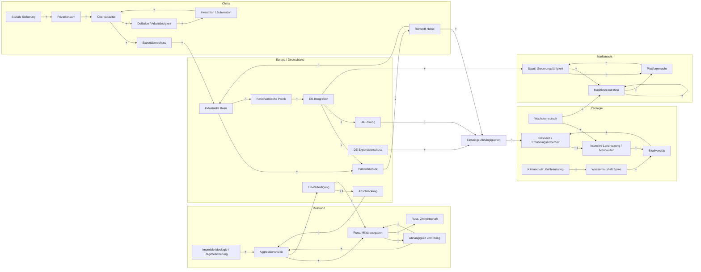

# 03 – Systemmodell (Version 0.1)

Ein Wirkungsnetz (Causal Loop Diagram). Die vollständige Liste der Knoten und Kanten steht in `data/model.json`.
Legende: `+` = gleichgerichtet (mehr A → mehr B), `−` = gegengerichtet (mehr A → weniger B), `‖` = mit Verzögerung.

## 1. Vier übergreifende Mechanismen

| Mechanismus | Wo er wirkt |
|---|---|
| **M1 Ungleichgewicht Produktion/Nachfrage** | China (Überkapazität), Russland (Kriegskeynesianismus), Deutschland (Exportüberschuss) |
| **M2 Abhängigkeit als Waffe** | Russland-Gas, China-Rohstoffe, Nahrungs- und Düngerimporte |
| **M3 Machtkonzentration** | Konzerne und Plattformen gegenüber staatlicher Steuerungsfähigkeit |
| **M4 Wachstumszwang gegen planetare Grenzen** | Monokulturen, Biodiversität, Zielkonflikte beim Klimaschutz |

## 2. Rückkopplungsschleifen

- **R1 Kriegswirtschafts-Falle (RU):**
  Militärausgaben ↑ → Abhängigkeit der Wirtschaft vom Krieg ↑ → Kosten eines Friedens ↑ → Militärausgaben ↑
- **B1 Abschreckung:**
  Russische Aggression ↑ → EU-Verteidigung ↑ ‖ → Abschreckung ↑ → Aggression ↓
- **R2 Sicherheitsdilemma:**
  EU-Verteidigung ↑ → wahrgenommene Bedrohung in RU ↑ → russische Militärausgaben ↑ → Aggressionsfähigkeit ↑ → EU-Verteidigung ↑
- **R3 Überkapazitäts-Spirale (CN):**
  Schwache soziale Sicherung → Vorsorgesparen ↑ → Konsum ↓ → Überkapazität ↑ → Deflation und Arbeitsplatzrisiko ↑
  → der Staat stützt mit mehr Investition und Subvention ↑ → Überkapazität ↑
- **R4 Handelskonflikt:**
  CN-Exportüberschuss ↑ → Druck auf EU-Industrie ↑ → Handelsschutz ↑ → Absatzproblem CN ↑ → Exportdruck auf Drittmärkte ↑
  - Zusatz: Handelsschutz ↑ → chinesische Rohstoff-Vergeltung ↑ → EU-Industrie ↓
- **R5 Konzentration:**
  Marktmacht ↑ → Gewinne ↑ → Übernahmen ↑ → Marktmacht ↑
- **R6 Regulierungserosion:**
  Plattformmacht ↑ → Lobbyeinfluss ↑ → staatliche Steuerungsfähigkeit ↓ → Regulierung ↓ → Plattformmacht ↑
- **R7 Deindustrialisierung und Populismus:**
  EU-Industrie ↓ → Abstiegsangst ↑ → nationalistische Politik ↑ → EU-Integration ↓ → Verhandlungsmacht gegenüber CN/US ↓ → EU-Industrie ↓
- **R8 Ökologische Verwundbarkeit:**
  Wachstumsdruck ↑ → intensive Landnutzung und Monokultur ↑ → Biodiversität ↓ → Resilienz der Ökosysteme ↓
  → Ernteausfälle ↑ → Ertragsdruck ↑ → intensive Landnutzung ↑
- **Zielkonflikt Z1 (kein Kreis):**
  Klimaschutz ↑ (Kohleausstieg) → Grundwasser-Abpumpung ↓ → Wasserführung der Spree ↓ → regionale Dürre/Biodiversität ↓

## 3. Diagramm (Ausschnitt)

## 4. Erste Hebel-Kandidaten (eingeordnet nach Meadows)

Meadows ordnet zwölf Hebelpunkte nach Wirkstärke. Die Nummer zeigt die Stufe: Je kleiner die Nummer, desto stärker der Hebel.

| Hebel | Akteur | Meadows-Stufe | Wirkt auf | Erwarteter Zielkonflikt |
|---|---|---|---|---|
| Verteidigungsausgaben | EU/DE | 12 Parameter (schwach) | B1 ↑, aber R2 ↑ | Haushalt, Wettrüsten |
| Ausgleichszölle / FSR | EU | 12 Parameter | EU-Industrie ↑ | Vergeltung (CN_RAW), Preise, langsamere Energiewende |
| De-Risking (Rohstoffe, Recycling, Reserven) | EU/Firmen | 10 Struktur (Bestände, Flüsse) | einseitige Abhängigkeit ↓ | Kosten, Zeit (5–15 J.) |
| Binnennachfrage DE (Löhne, Investitionen) | DE | 8 Rückkopplung | DE-Überschuss ↓ | Wettbewerbsfähigkeit |
| Soziale Sicherung in CN | CN (nur indirekt beeinflussbar) | 7 verstärkende Schleife brechen (R3) | Konsum ↑, Überkapazität ↓ | Übergangsarbeitslosigkeit |
| Fusionskontrolle / DMA | EU | 5 Regeln | R5/R6 ↓ | Draghi: Skalierung |
| EU-Integrationstiefe | EU-Staaten | 5 Regeln / 4 Selbstorganisation | Verhandlungsmacht ↑ | Souveränitätsfragen, R7 |
| Agrarpolitik: Vielfalt statt Menge | EU (GAP) | 3 Ziele | Biodiversität ↑, Resilienz ↑ | kurzfristig Ertrag ↓ |
| Wachstumsziel infrage stellen | Gesellschaft | 2 Paradigma (sehr stark) | M4 insgesamt | Hochgradig umstritten (KO-02) |

## 5. Bekannte Lücken im Modell

Diese Faktoren fehlen in den Ausgangsthesen, sind für das Gesamtbild aber entscheidend:
- **USA:** Zölle ab 2025, Unsicherheit über die Verlässlichkeit in der NATO, Tech-Macht
- **Energiepreise** als Standortfaktor
- **Klimawandel** selbst als Treiber (Dürren, Ernten, Migration)
- **Demografie:** Alterung in CN, DE und RU
- **Staatsverschuldung und Zinsen:** Spielraum für Rüstung und Investitionen
- **Globaler Süden:** Indien, Golfstaaten, BRICS als Ausweichmärkte und Rohstofflieferanten
- **Technologie/KI** als neuer Knotenpunkt für Abhängigkeit und Macht
